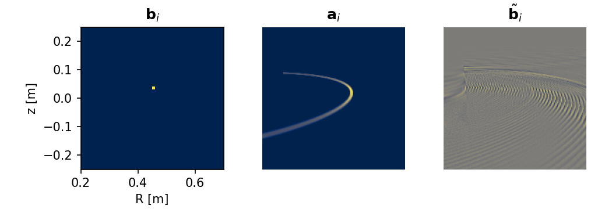
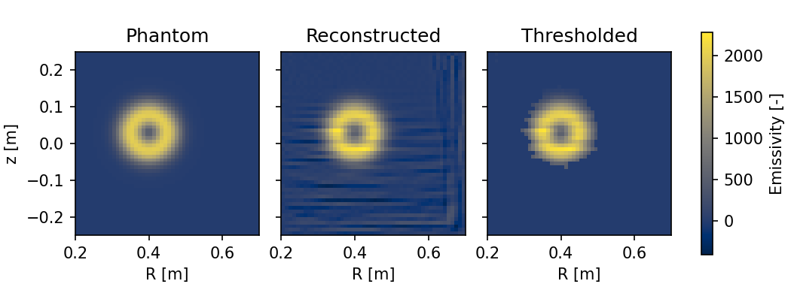

Biorthogonal Basis Decomposition
================================

The biorthogonal basis decomposition (BoB) algorithm was first introduced in [B1]_ as a wavelet-vaguelette decomposition. It utilised a wavelet basis that allowed noise suppression by the so-called thresholding method. It was later modified in [B2]_ for a simple node basis in the reconstruction plane and successfully used for edge plasma tomography using a fast visible camera. The noise suppression capability of this simplified version is limited compared to the original algorithm, but it still performs well enough to enable the use of thresholding for studies of blob movement in the edge plasma.

This method is not regularised, which means that it requires at least as many channels as there are nodes in the reconstruction plane (:math:`N_\mathrm{c} \geq N_\mathrm{n}`) to run reliably, i.e. the problem has to be over-determined (see also chapter 5 of [B3]_). It is therefore not suitable for systems consisting of linear detector arrays, where the number of channels is usually significantly lower, but it is well suited to matrix camera systems or systems with a large number of lines of sight.

The main advantage of this approach is that the results are obtained by a simple matrix multiplication of the decomposition matrix and the signals. The decomposition matrix is computed only once for a given reconstruction grid and geometry setup, making this algorithm suitable for inversion of many time slices. However, the thresholding method has to be applied to each inversion result individually.

Vector spaces and bases
-----------------------

As the name suggests, this algorithm uses multiple vector spaces and bases to solve the tomography problem.

The **reconstruction space** contains all possible solutions of the tomography problem on a given grid. Its elementary basis :math:`\mathbf{e} = (\mathbf{e}_1, \dots, \mathbf{e}_{N_\mathrm{n}})` is given by the basis functions of the series expansion, e.g. by individual nodes of the grid. Any discretised solution :math:`\mathbf{g} \in \mathbb{R}^{N_\mathrm{n}}` holds the coordinates of the emissivity in this basis.

The **decomposition basis** :math:`\mathbf{b} = (\mathbf{b}_1, \dots, \mathbf{b}_{N_\mathrm{d}})` is also selected by the user. Each vector :math:`\mathbf{b}_i` holds the coordinates of a decomposition vector in the elementary basis and the vectors should be selected so that the basis is orthonormal. If the simple node basis is used, then :math:`N_\mathrm{d} = N_\mathrm{n}` and each basis vector holds one at the position of the node it represents and zero elsewhere, i.e. the basis can be represented by an identity matrix. For wavelet bases, each vector consists of wavelet coefficients.

The **signal space** :math:`\mathbb{R}^{N_\mathrm{c}}` encompasses all possible signals that a diagnostic system with :math:`N_\mathrm{c}` channels (or camera pixels) can record. Its subspace, the **projection space**, holds all signals obtainable as a linear combination of projections of the basis functions. It is the image of the linear map :math:`T: \mathbb{R}^{N_\mathrm{n}} \to \mathbb{R}^{N_\mathrm{c}}` defined by the geometry matrix, :math:`T\mathbf{g} = \mathbf{T} \cdot \mathbf{g}`.

Two more sets of vectors from the projection space are used by the algorithm. Unlike the previous bases, they are not selected by the user but are defined by the relations

.. math::
    T \mathbf{b}_{i} = \kappa_{i} \mathbf{a}_{i} \,, \qquad
    T^{*} \tilde{\mathbf{b}}_{i} = \kappa_{i} \mathbf{b}_i \,,

where :math:`T^*` is the adjoint operator of the linear map :math:`T` and :math:`\kappa_{i}` are normalisation factors chosen so that each vector :math:`\tilde{\mathbf{b}}_i` is normalised. The adjoint operator satisfies for any :math:`\mathbf{x}` from the reconstruction space and :math:`\mathbf{y}` from the projection space

.. math::
    ( T \mathbf{x}) \cdot \mathbf{y} = \mathbf{x} \cdot (T^{*} \mathbf{y} ) \,.

The set :math:`\mathbf{a}` holds the projections of the decomposition basis vectors to the signal space. If these projections are linearly independent, the set forms the **projection basis**. The set :math:`\tilde{\mathbf{b}}` is called the **adjoint basis** and it is the basis searched for by the algorithm, since it allows the solution to be computed directly from the signals.

.. Figures on this page are generated by figures/make_bob_figures.py

    An example of the vectors used by the algorithm for a matrix camera with a tangential view and the simple node basis of toroidally symmetric nodes with rectangular projection to the poloidal plane. A decomposition basis vector (left), its projection to the camera image (centre) and the corresponding vector of the adjoint basis (right).

Solution
--------

The solution can be expressed in the decomposition basis and transformed to the elementary basis as

.. math::
    \mathbf{g} = \sum_{i=1}^{N_\mathrm{d}} \left( \mathbf{b}_{i} \cdot \mathbf{g} \right) \mathbf{b}_{i} \,.

Using the definition of the adjoint basis and of the adjoint operator, the coordinates of the solution in the decomposition basis are

.. math::
    \mathbf{b}_{i} \cdot \mathbf{g}
    = \frac{1}{\kappa_i} \left( T^* \tilde{\mathbf{b}}_{i} \right) \cdot \mathbf{g}
    = \frac{1}{\kappa_i} \tilde{\mathbf{b}}_{i} \cdot \left( T \mathbf{g} \right)
    = \frac{1}{\kappa_i} \tilde{\mathbf{b}}_{i} \cdot \mathbf{f} \,,

which shows that knowledge of the adjoint basis allows the emissivity :math:`\mathbf{g}` to be recovered from the measured signal :math:`\mathbf{f}`.

The adjoint basis is found using the fact that the bases :math:`\mathbf{a}` and :math:`\tilde{\mathbf{b}}` are biorthogonal. Similarly to the previous derivation,

.. math::
    \tilde{\mathbf{b}}_{i} \cdot \mathbf{a}_{j}
    = \frac{1}{\kappa_j} \tilde{\mathbf{b}}_{i} \cdot \left( T \mathbf{b}_{j} \right)
    = \frac{1}{\kappa_j} \left( T^* \tilde{\mathbf{b}}_{i} \right) \cdot \mathbf{b}_{j}
    = \frac{\kappa_i}{\kappa_j} \mathbf{b}_{i} \cdot \mathbf{b}_{j}
    = \delta_{ij} \,,

where the orthonormality of the decomposition basis is used and :math:`\delta_{ij}` is the Kronecker delta. Since both :math:`\mathbf{a}` and :math:`\tilde{\mathbf{b}}` are bases of the projection space, the adjoint basis vectors can be expressed in the projection basis. Constructing a matrix :math:`\mathbf{A} = \mathbf{T} \cdot \mathbf{B}` with projections of the decomposition basis vectors in columns (the normalisation :math:`\kappa_i` can be absorbed into the adjoint basis), the biorthogonality condition leads to

.. math::
    \tilde{\mathbf{B}} = \mathbf{A} \cdot \mathbf{C} \,, \qquad
    \mathbf{C} \cdot \left( \mathbf{A}^T \cdot \mathbf{A} \right) = \mathbf{I} \,,

where :math:`\tilde{\mathbf{B}}` has the adjoint basis vectors in columns and the symmetric matrix :math:`\mathbf{C}` holds their coordinates in the projection basis. Finding :math:`\mathbf{C}` is mathematically identical to computing the inverse of :math:`\mathbf{A}^T \cdot \mathbf{A}`, so that :math:`\tilde{\mathbf{B}}^T` is the pseudoinverse of :math:`\mathbf{A}`. The solution is then obtained as :math:`\mathbf{g} = \mathbf{B} \cdot \tilde{\mathbf{B}}^T \cdot \mathbf{f}`.

Invertibility
^^^^^^^^^^^^^

The derivation above assumes that the adjoint basis exists, i.e. that the linear map :math:`T` is invertible as a map onto the projection space. The geometry matrix has shape :math:`N_\mathrm{c} \times N_\mathrm{n}` and, unless :math:`N_\mathrm{c} = N_\mathrm{n}`, it is not square and therefore not invertible. However, if the codomain of :math:`T` is restricted to the projection space, the map might be invertible. The dimension of the domain is equal to the number of decomposition vectors :math:`N_\mathrm{d}`, while the dimension of the projection space is at most :math:`\min(N_\mathrm{c}, N_\mathrm{d})`.

- If :math:`N_\mathrm{c} < N_\mathrm{d}`, the dimensions differ and the map is not invertible. The nullity of the map is non-zero, there are infinitely many possible solutions and a regularised method has to be used instead.
- If :math:`N_\mathrm{c} \geq N_\mathrm{d}`, the map is invertible if the projections of the decomposition basis vectors are linearly independent. In practice, all decomposition vectors must be observed by the diagnostic system and their projections to the signal space must be distinct. A typical tangentially viewing matrix camera fulfils these conditions if a properly constructed grid is used.

Restricting the signals to the projection space formally justifies the computation of the adjoint basis. However, every measurement is affected by noise and it is very unlikely that a noisy camera image can be precisely described as a linear combination of the decomposition basis projections. Noise can cause problems especially if the simple node basis is used. It is therefore better to ensure that there are significantly more channels than decomposition vectors, :math:`N_\mathrm{c} \gg N_\mathrm{d}`.

Thresholding
------------

Thresholding is a method for noise suppression in the reconstruction. It is based on the assumption that the noise is spread over many decomposition vectors while the signal is concentrated in a few of them [B1]_. This assumption expects a wavelet decomposition basis, but thresholding can be used with the single node basis as well. It can still suppress background noise and enhance the most prominent features in the reconstruction, which proved useful for blob tracking in the edge plasma [B2]_.

The method compares the sizes of the normalised coefficients :math:`a_i = |\tilde{\mathbf{b}}_i \cdot \mathbf{f}| / \|\tilde{\mathbf{b}}_i\|` and removes contributions of adjoint vectors below a threshold. Since the level of noise is not known, the threshold is determined iteratively for each image as a multiple of the root mean square of the coefficients considered to be noise

.. math::
    \left( \Theta^{n+1} \right)^2 = \frac{c^2}{N^n} \sum_{i \in S^n} a_i^2 \,, \qquad
    S^n = \left\{ i \mid a_i \leq \Theta^n \right\} \,,

where :math:`c` is the noise suppression parameter and :math:`N^n` is the number of coefficients in the set :math:`S^n`. The iteration starts with :math:`\Theta^0 = \infty`, i.e. all coefficients are used, and stops when the threshold converges. The coefficients with :math:`a_i < \Theta` are then set to zero and the remaining ones are transformed to the elementary basis.

    A phantom used to create a noisy synthetic image of a tangentially viewing camera with 200 by 200 pixels, its reconstruction using the simple node basis on a grid of 50 by 50 nodes, and the same result after thresholding with :math:`c = 3.4`. The stripes in the reconstruction are caused by noise, which cannot be described as a linear combination of the projections of decomposition basis vectors.

Implementation
--------------

The algorithm is implemented in :class:`~tomotok.inversions.bob.Bob`. The ``decompose`` method computes the adjoint basis from the geometry matrix and the decomposition basis; the result can be stored using ``save_decomposition`` and reused with ``load_decomposition``. The ``invert`` method (or calling the instance) computes the reconstruction by matrix multiplication and ``thresholding`` applies the thresholding method with sensitivity ``c`` to a single image.

No tools for creating wavelet bases are currently provided; a simple node basis represented by an identity matrix can be used.

The decomposition is implemented using sparse matrices. The inverse of :math:`\mathbf{A}^T \cdot \mathbf{A}` is computed by a :class:`~tomotok.inversions.solvers.base.Solver` backend, by default the dense :class:`~tomotok.inversions.solvers.scipy.CholeskySolver`. Alternatives are :class:`~tomotok.inversions.bob.SparseInvSolver` using the sparse inverse from SciPy, or sparse Cholesky decomposition from the optional backends. The Cholesky decomposition requires the matrix to be positive definite. This requires the projections of all decomposition basis vectors to be linearly independent, which is not always the case for visible cameras and the simple node basis, e.g. when some nodes are not observed or have nearly identical projections. Therefore, a simple regularisation by the identity matrix, equivalent to the standard Tikhonov regularisation, can be enabled by the ``reg_factor`` parameter. It is given relative to the maximum of the inverted matrix and typical values are lower than 0.001.

References
----------

.. [B1] R. Nguyen Van Yen, N. Fedorczak, F. Brochard, G. Bonhomme, K. Schneider, M. Farge et al., Tomographic reconstruction of tokamak plasma light emission from single image using wavelet-vaguelette decomposition, Nucl. Fusion 52 (2011) 013005.

.. [B2] J. Cavalier, N. Lemoine, F. Brochard, V. Weinzettl, J. Seidl, S. Silburn et al., Tomographic reconstruction of tokamak edge turbulence from single visible camera data and automatic turbulence structure tracking, Nucl. Fusion 59 (2019) 056025.

.. [B3] S. Mallat, A Wavelet Tour of Signal Processing - The Sparse Way. Elsevier, third ed., 2009.
